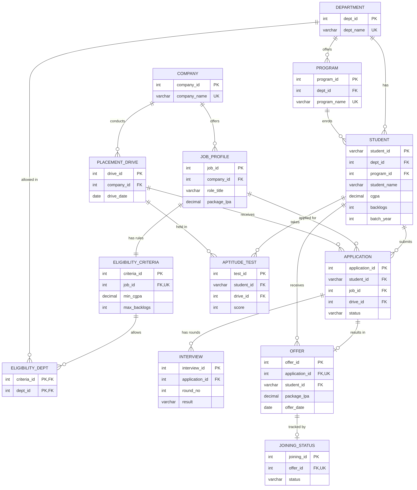

# University Placement & Recruitment Management System (Case Study 8)

A complete Oracle database for a university placement office. It stores students, companies, jobs, eligibility rules, placement drives, applications, aptitude tests, interviews, offers and joining status. It then answers the placement office's questions with SQL and classifies every student's **placement readiness**.



---

## 1. The story in plain words

A placement season works like this, and the database follows the same steps:

1. The university has **departments** (CSE, ECE, MECH). Each runs **programs** (B.Tech CSE…), and **students** study in them with a CGPA.
2. **Companies** (TCS, Infosys, Zoho, L&T) come to hire. Each offers **job profiles** with a package in LPA (lakhs per annum).
3. Every job has **eligibility criteria**: a minimum CGPA, maximum backlogs, and which departments may apply.
4. A company holds a **placement drive** on a date. Students **apply** to a job in that drive.
5. Students write an **aptitude test** (pass mark 60), then go through **interview rounds** (Pass/Fail).
6. Students who clear everything are **Selected** and get an **offer** with a package.
7. Finally the student **joins**, **declines**, or is still **pending** (**joining status**).

The 13 tables are exactly these 13 nouns.

---

## 2. Files in this folder

| File | What it does |
|---|---|
| `00_cleanup.sql` | Deletes all of this project's tables and views so you can start fresh |
| `01_tables.sql` | Creates the 13 tables with every constraint (PK, FK, UNIQUE, CHECK, NOT NULL, DEFAULT) |
| `02_data.sql` | Inserts the sample data |
| `03_queries.sql` | 39 queries: all analysis questions, plus modification and deletion demos |
| `04_views.sql` | Creates 9 views and shows their output, including the readiness classification |
| `05_integrity.sql` | 34 statements that are **meant to fail**, proving the constraints work |
| `run_all.sql` | Runs 01 → 05 in one go in SQL*Plus |
| `er_diagram.png` | The ER diagram above |

---

## 3. How to run it (Oracle SQL*Plus, Windows)

**One-time setup:** create a separate user, so the project never touches your other lab tables.
```
sqlplus system
CREATE USER c##placement IDENTIFIED BY placement;
GRANT CONNECT, RESOURCE, CREATE VIEW, UNLIMITED TABLESPACE TO c##placement;
EXIT
```

**Every time:** open Command Prompt **inside this folder**.
```
cd C:\Users\<you>\Downloads\placement_db
sqlplus c##placement/placement
```
Then type one line at a time:
```
SET ECHO ON
@00_cleanup.sql
@run_all.sql
```
- `SET ECHO ON` prints each query above its result, which you need for a demo.
- On a first run `00_cleanup.sql` prints "table or view does not exist" for every line. That's normal.
- The errors at the very end (section 5) are **on purpose**.
- To run again from scratch: `@00_cleanup.sql`, then `@run_all.sql`.


## 4. The 13 tables

| Table | Holds | Key columns | Notable constraints |
|---|---|---|---|
| department | CSE, ECE, MECH | dept_id PK | dept_name UNIQUE |
| program | B.Tech/M.Tech programs | program_id PK, dept_id FK | UNIQUE (program_id, dept_id) |
| student | 10 students | student_id PK ('S101'), dept_id FK, program_id FK | CGPA CHECK 0–10, backlogs DEFAULT 0, **composite FK** (program must belong to the student's department) |
| company | 4 recruiters | company_id PK | company_name UNIQUE |
| job_profile | 5 roles with package | job_id PK, company_id FK | package CHECK > 0 |
| eligibility_criteria | rules per job | criteria_id PK, job_id FK UNIQUE (1:1) | min_cgpa CHECK 0–10, cascade on job delete |
| eligibility_dept | which departments may apply | PK (criteria_id, dept_id) | **bridge table** for an M:N |
| placement_drive | company visits | drive_id PK, company_id FK | UNIQUE (company, date) |
| application | student applies to a job in a drive | application_id PK, 3 FKs | status CHECK ('Applied','Selected','Rejected'), DEFAULT 'Applied', UNIQUE (student, job, drive) |
| aptitude_test | one test per student per drive | test_id PK | score CHECK 0–100, UNIQUE (student, drive) |
| interview | rounds per application | interview_id PK | result CHECK ('Pass','Fail','Pending'), UNIQUE (application, round) |
| offer | job offers | offer_id PK, application_id FK UNIQUE | package CHECK, offer_date NOT NULL |
| joining_status | joined or not | joining_id PK, offer_id FK UNIQUE | status CHECK ('Joined','Pending','Declined'), DEFAULT 'Pending' |

**Relationships (read with the ER diagram)**
- 1:N: department → program → student; company → job_profile; company → placement_drive; application → interview.
- 1:1: job_profile ↔ eligibility_criteria; application ↔ offer (at most one); offer ↔ joining_status.
- **M:N resolved by bridge tables:**
  - student ↔ job is resolved by **application**, which also records the drive and the status
  - criteria ↔ department is resolved by **eligibility_dept**
- **ON DELETE CASCADE** where a child means nothing alone: job → criteria → allowed depts, application → interviews → offer → joining.
  Everywhere else deletes are **restricted** (you can't delete a company, student or drive that has history).

All tables are in **3NF**: every fact is stored once (a department's name only in `department`, a job's package only in `job_profile`), and every column depends only on its table's key.

---

## 5. Business rules

1. A student is **eligible** for a job only if CGPA ≥ min CGPA, backlogs ≤ max backlogs, and their department is allowed.
2. A student applies at most once per job per drive. An application starts as 'Applied' and ends 'Selected' or 'Rejected'.
3. The drive of an application belongs to the same company as the job.
4. One aptitude test per student per drive (score 0–100, pass ≥ 60). Interview rounds are numbered and never repeated.
5. Only a 'Selected' application gets an offer, and at most one.
6. A student joins at most one company; their other offers are 'Declined'.
7. **Placed = the student has at least one offer**, whatever the joining status.

Rules that a constraint can't express (1, 3, 5, 6) are verified by check queries in `05_integrity.sql`, which must return **no rows**.

---

## 6. Sample data at a glance

| Students | Dept | CGPA | Result |
|---|---|---|---|
| S101 | CSE | 6.40 | failed both aptitude tests → **no offer** |
| S301 | CSE | 9.10 | Zoho 11 + Infosys 6.5 |
| S303 | CSE | 8.20 | Zoho 11 + TCS Digital 7.5 |
| S307 | CSE | 7.40 | Infosys 6.5 (a TCS application is still 'Applied') |
| S205 | ECE | 8.60 | Zoho 11 (failed a TCS interview) |
| S304 | ECE | 7.80 | Zoho 11 + Infosys 6.5 |
| S306 | ECE | 6.90 | TCS Ninja 4 |
| S302 | MECH | 6.60 | TCS Ninja 4 |
| S305 | MECH | 7.20 | Infosys 6.5 (failed L&T round 2) |
| S308 | MECH | 7.60 | TCS Digital 7.5 + TCS Ninja 4 |

Jobs: TCS Ninja 4.00, Infosys Systems Engineer 6.50, Zoho MTS 11.00, TCS Digital 7.50, L&T GET 7.00.
Totals: 6 drives, 21 applications, 19 aptitude tests, 30 interview rounds, 13 offers.

---

## 7. What the queries answer (`03_queries.sql`)

| Question paper item | Query | Answer |
|---|---|---|
| Eligible students for each company | Q8, Q9 | TCS 10, Infosys 10, L&T 6, Zoho 5 |
| Company-wise applications | Q14 | TCS 8, Infosys 6, Zoho 4, L&T 3 |
| Placement-drive participation | Q15 | TCS 70%, Infosys 60%, Zoho 40%, L&T 30% of students |
| Selection rate | Q16, Q17 | Zoho 100%, Infosys 66.67%, TCS 62.5%, L&T 0%. Overall 61.90% |
| Department-wise placement % | Q2, Q3 | CSE 75%, ECE 100%, MECH 100%. University 90% |
| Average package | Q29–Q31 | 7.46 LPA. Zoho 11, Infosys 6.5, TCS 5.4. CSE 8.5, ECE 8.13, MECH 5.5 |
| Highest and lowest packages | Q32, Q33 | 11.00 (Zoho) and 4.00 (TCS), with student names |
| Students with multiple offers | Q34 | S301, S303, S304, S308 |
| Companies with highest recruitment success | Q10, Q11 | TCS (5 offers) |
| **Advanced:** multi-table join | Q19 (5 tables), Q33 | |
| **Advanced:** subqueries | Q4, Q5, Q11, Q18 | |
| **Advanced:** correlated subquery | Q35, Q26 | |
| **Determine:** selected above their department average | Q35 | S301, S303 (CSE avg 8.5), S205, S304 (ECE avg 8.13), S305, S308 (MECH avg 5.5) |
| **Determine:** companies above the overall selection rate | Q18 | Zoho, Infosys, TCS |
| **Determine:** departments below the university average | Q4 | CSE (75% < 90%) |
| Modification and deletion | Q6, Q12, Q13, Q20, Q21, Q28, Q37–Q39 | Updates, an update with a subquery, cascade deletes |

How the main ones work:
- **Placement %**: `COUNT(DISTINCT offer.student_id) / COUNT(DISTINCT student_id)` with `student LEFT JOIN offer`. The LEFT JOIN keeps unplaced students in the count, and DISTINCT stops a two-offer student counting twice.
- **Eligibility**: join job → criteria → eligibility_dept → student on dept_id, then filter on CGPA and backlogs.
- **Selection rate**: `SUM(CASE WHEN status='Selected' THEN 1 ELSE 0 END) / COUNT(*)`.
- **Correlated subquery (Q35)**: the inner `AVG(package)` uses the outer row's department, so it is re-run for every offer.

Q37–Q39 change data (a Zoho package becomes 12.00), so the views in `04_views.sql` show those updated values.

---

## 8. Views (`04_views.sql`)

| View | Shows |
|---|---|
| v_dept_placement_summary | total, placed, % per department |
| v_eligible_students | every eligible (company, job, student) |
| v_company_recruitment | jobs, offers made, best package per company |
| v_company_selection_rate | applications, selected, rate per company |
| v_application_details | every application with names, company, role, date, status |
| v_readiness_indicators | the 4 readiness indicators per student |
| v_placement_readiness | readiness score and class per student |
| v_offer_details | every offer with student, company, package, joining status |
| v_package_summary | average/highest/lowest package per department |

---

## 9. Task 5: Placement Readiness Decision-Support System

**Indicators, all computed from the database:**
- **CGPA**: from `student`
- **Aptitude score**: the average of the student's aptitude tests
- **Interview success**: the number of interview rounds passed
- **Offers**: the number of offers received

**Score out of 100:**
```
score = 0.35 × (CGPA × 10)  +  0.35 × aptitude
      + 0.15 × (min(interview_success, 4) × 25)  +  0.15 × (min(offers, 1) × 100)
```

**Classes (checked top to bottom):**
| Condition | Readiness |
|---|---|
| CGPA < 6 or aptitude < 40 | NEEDS INTERVENTION (red flag) |
| score ≥ 75 | PLACEMENT READY |
| 60–75 | MODERATELY READY |
| 45–60 | NEEDS TRAINING |
| below 45 | NEEDS INTERVENTION |

**Matches the question paper exactly:**
| Student | Dept | CGPA | Aptitude | Interview success | Offers | Score | Readiness |
|---|---|---|---|---|---|---|---|
| S101 | CSE | 6.4 | 48 | 0 | 0 | 39.2 | NEEDS INTERVENTION |
| S205 | ECE | 8.6 | 86 | 2 | 1 | 82.7 | PLACEMENT READY |

S205's working: 30.1 + 30.1 + 7.5 + 15 = 82.7.
All 10 students: 6 PLACEMENT READY, 3 MODERATELY READY, 1 NEEDS INTERVENTION (S101, also the only unplaced student).

---

## 10. Integrity demo (`05_integrity.sql`)

Each statement breaks a rule on purpose, and Oracle refuses it:
| Oracle error | Meaning | Example in the file |
|---|---|---|
| ORA-02291 parent key not found | FK: the referenced row doesn't exist | offer for application 999 |
| ORA-02292 child record found | FK restrict: can't delete a parent with children | delete student S301 |
| ORA-02290 check constraint violated | CHECK | CGPA 11, package −3, status 'Accepted' |
| ORA-00001 unique constraint violated | UNIQUE / PK | second 'TCS', duplicate application |
| ORA-01400 cannot insert NULL | NOT NULL | offer without a date |

The file ends with business-rule checks that print **no rows selected**, which means the data obeys rules 1, 3, 5 and 6.
